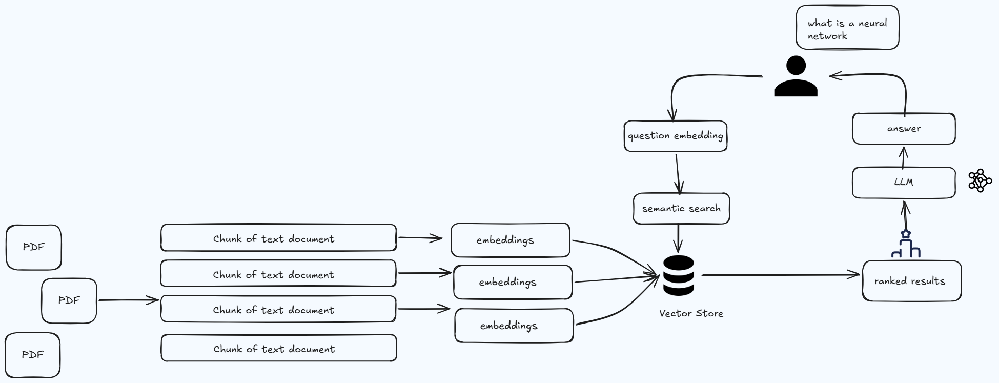
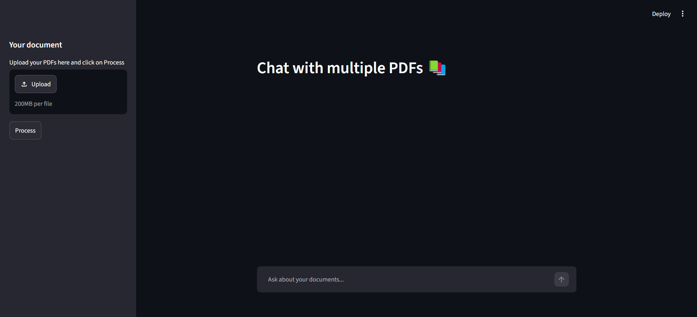
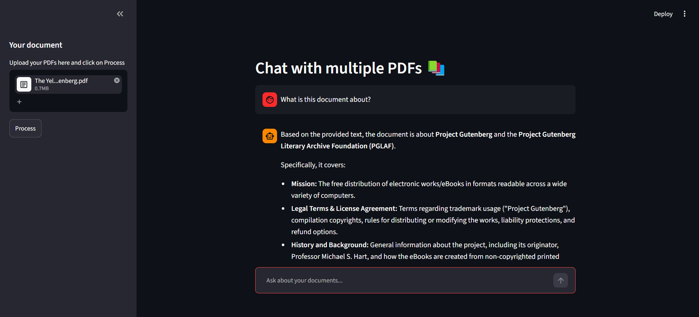

<div align="center">

# LangChain Multi-PDF AI Chat Assistant
[](https://www.python.org/)
[](https://streamlit.io/)
[](https://www.langchain.com/)
[](https://ai.google.dev/)

</div>

## Overview

An AI-powered PDF question-answering application that allows users to upload multiple PDF documents 
and interact with their contents through natural language conversations.

The app uses RAG to retrieve relevant document context and generate meaningful responses.

---

## System Architecture

<p align="center">
  
</p>

---

## Application Interface

| Document Upload & Processing | Interactive Q&A Session |
| :---: | :---: |
|  |  |

---

## Features

- **Multi-PDF Support**: Upload and analyze multiple documents in one session.
- **Google Gemini 3.5 Flash**: Fast, grounded conversational answers.
- **FAISS Vector Search**: Semantic retrieval with Google `gemini-embedding-001`.
- **Context-Aware Memory**: Retains conversation history for continuous multi-turn dialogue.

---

## Quick Start

```bash
pip install -r requirements.txt
streamlit run app.py
```

> Set `GOOGLE_API_KEY=your_api_key_here` in `.env` before running.


Developed using Python, LangChain & Google Gemini

